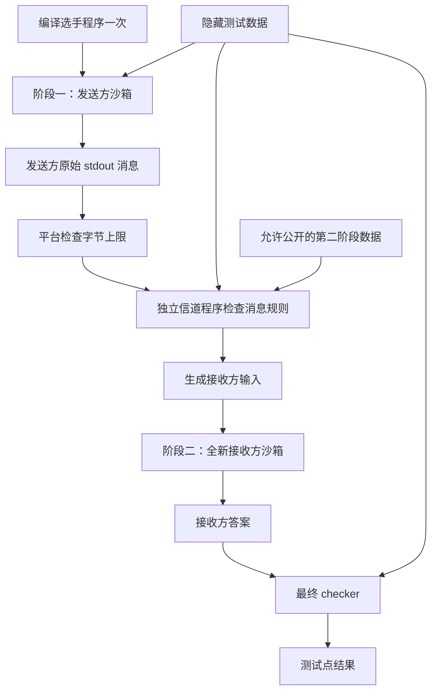

# QOJ 通信题设计档案

- 日期：2026-10-12
- 状态：已集成两阶段通信评测；本档案保留设计说明，实际操作以开头的接入说明为准。
- 适用项目：当前 React / Spring Boot / go-judge 架构的 QOJ
- 第一版范围：单向、两个阶段、隔离运行的编码与解码通信题
- 交付目标：选手程序运行两次，两次之间只能传递题目允许的消息

## 当前接入方式

后台“新建题目”可下载示例包并点击“导入通信题包”。整包在内存中校验后一次替换当前草稿，默认私有、未发布；检查后再创建题目。也可在新建或编辑页面选择“通信题（两阶段）”，配置消息上限、允许空消息、信道源码和最终检查器，并在测试点页填写公开数据或上传数据 ZIP。

- 示例：[最小通信题](examples/communication/README.md)，下载文件为 `public/examples/communication-example.zip`。
- 整包入口：`POST /api/{后台前缀}/v1/problem-drafts/{draftId}/communication-package`，表单字段 `file`。
- 配置采用 `communication.enabled=true`、`version=1`，源码字段保存实际文本；整包 `problem.json` 中源码字段则为包内路径。
- 数据文件：`N.in`、`N.out` 或 `N.ans`、`N.public2.in`。通信题参考答案、公开输入可空。200 点以内，压缩包及解压文本总量均不超过 50MB。
- V108 增加 `problems.communication_config`、`problem_test_cases.public_input`；`judgeMode` 由通信配置和原 SPJ 字段计算，旧题目无需回填。
- 练习和比赛共用通信评测；任务领取时复制完整配置，单次提交的两个阶段不会混用编辑后的源码。结果保存失败阶段、消息字节数和两阶段资源使用；总时间/内存取两阶段最大值。
- 前台使用现有 beUI 组件展示模式和协议。样例可包含 ENCODE 或 DECODE 标记，样例解释描述完整阶段记录。自测执行一个阶段，完整流程通过提交评测。
- 通信消息必须是合法 UTF-8，预算计入换行且不包含 stderr。裁判输出不对选手透出；信道输出须以 `DECODE` 换行开头。
- 题目源码仍为完整程序，同一编译产物运行两次；不提供实时交互、多个选手进程或任意轮通信。

部署时替换前后端并重启后端，让 Flyway 自动执行 V108；继续使用现有 go-judge，无需修改其源码或增加独立通信服务。升级前按现有流程备份数据库。验证命令：`node tools/e2e/communication-tasks.mjs`；报告、真实提交结果和浏览器截图保存在 `output/communication-e2e/`。


## 1. 题型定义与范围

第一阶段为发送方 Alice：读取第一阶段输入，输出一份消息后退出。

第二阶段为接收方 Bob：在全新的运行环境中启动，只读取允许公开的第二阶段信息和经过校验的消息，输出答案后退出。

两阶段不同时运行，不连接实时双向管道，不提供询问与即时回复。第一版不实现普通交互题、多参与者实时通信、动态启动选手实例或任意轮数的通信。

例如：Alice 看到一个排列，只能发送最多 K 个字符；Bob 根据这份消息及题目允许公开的信息恢复指定结果。消息可以是文本、整数序列或位串；不同表示形式的预算由题目明确规定。

## 2. 技术选型

采用“分阶段运行 + 独立信道校验程序 + 最终 checker”，继续使用 go-judge 执行所有程序。

选手程序、信道程序和 checker 均在沙箱内执行。信道程序及 checker 属于出题方程序，具有读取该测试点秘密数据的权限，但仍需资源限制。Java 后端负责顺序编排、结果转换、文件生命周期和权限控制。

不为此引入 CMS 整个平台或第二套沙箱。参考 CMS 将秘密数据与选手程序分离的原则，以及现有 multi-pass 方案在两轮之间生成输入的做法。

相关公开资料：

- [CMS Communication 文档](https://cms.readthedocs.io/en/latest/Task%20types.html)：独立 manager、选手进程及 grader 的职责划分；文档警告旧 TwoSteps 模式的安全问题。
- [CMS Communication 实现](https://github.com/cms-dev/cms/blob/master/cms/grading/tasktypes/Communication.py)：多进程通信的参考实现；本项目第一版只借鉴隔离原则，不实现其并发 FIFO 模型。
- [Polygon / Codeforces run-twice 作者教程](https://codeforces.com/blog/entry/142052)：程序两次运行及中间数据传递的实践；该教程明确为非官方资料，不依赖其未稳定的内部 API。
- [Problem Package Format 2025-09](https://icpc.io/problem-package-format/spec/2025-09.html)：multi-pass、下一轮输入及阶段资源限制的公开约定。第一版使用 QOJ 自有简化包格式，不宣称完整兼容该标准。
- [go-judge API](https://github.com/criyle/go-judge-doc/blob/master/src/api.md)：程序执行、文件缓存及清理能力。

## 3. 单测试点执行流程



执行顺序：

1. 校验题目配置，编译选手程序、信道程序和 checker。
2. 给阶段一沙箱复制选手编译产物和该阶段允许读取的输入，运行发送方。
3. 平台检查发送方 stdout 的实际字节数。stderr 不属于通信消息。
4. 在独立沙箱中运行信道程序，验证消息格式和题意要求，生成接收方输入。
5. 给新的阶段二沙箱复制相同的选手编译产物及接收方输入，运行接收方。
6. 在独立沙箱中运行 checker，判定接收方输出。
7. 保存有界诊断记录，清理两阶段及裁判程序产生的缓存文件。

任意一步失败即停止该测试点。第一版每个隐藏测试点对应一对阶段，不在一次进程内混跑多个隐藏测试点。

## 4. 选手提交方式

第一版提交一个完整程序，系统编译一次、运行两次。标准输入第一行指定阶段：

```text
ENCODE
第一阶段输入……
```

```text
DECODE
第二阶段输入……
```

阶段一 stdout 全部作为原始消息；阶段二 stdout 全部作为最终答案。具体消息和第二阶段正文的格式必须在题面中说明。

阶段标识只是程序分支条件，不是安全措施。真正的信息隔离来自两个独立执行环境及不同的输入文件。

沿用当前允许的 C、C++、Java、Python 编译链路。第二阶段与第一阶段使用同一份提交的编译产物，不允许用户在阶段之间修改源码或携带自行生成的可执行文件。

后续可以增加函数提交模式，如 `encode()` / `decode()`，由各语言 grader 包装；第一版不要求为所有语言实现 grader。grader 与选手代码同进程，不能持有需要对该进程隐藏的信息，也不能单独承担通信预算校验。

## 5. 信道程序与 checker 约定

第一版裁判源码固定使用 C++17。信道程序可以复用 testlib 的输入解析与退出码约定，作为普通独立程序顺序执行，不调用 `registerInteraction`。

建议固定调用接口：

```text
channel input.txt sender.out answer.txt public2.txt
checker input.txt receiver.out answer.txt
```

其中：

| 文件 | 含义 | 选手是否可直接读取 |
| --- | --- | --- |
| `input.txt` | 原始测试点数据 | 仅阶段一得到按题意准备的内容；阶段二不挂载此文件 |
| `sender.out` | 发送方原始消息 | 仅通过题目定义的信道传入阶段二 |
| `public2.txt` | 允许公开的第二阶段附加数据，可为空 | 由信道程序按协议传入阶段二 |
| `answer.txt` | 裁判参考答案或辅助秘密数据，可为空 | 否 |
| `receiver.out` | 接收方最终答案 | 供最终 checker 检查 |

信道程序 stdout 必须输出完整的接收方输入，包括 `DECODE` 阶段标识。输出为 UTF-8 文本，大小受独立上限约束；stderr 用于有界诊断。

信道程序需要检查：字符集、整数范围、位数、元素个数、结构合法性以及题目规定的其他通信约束。平台先检查消息字节硬上限，再由信道程序检查语义预算，例如“最多 K 位”或“最多 K 个整数”。不能只相信选手自行声明的消息长度。

信道程序和 checker 的退出码约定为：0 通过，1/2 为答案或格式错误，3 为裁判错误；其他异常退出按裁判错误处理。第一版只做通过/不通过，不开放部分分和评分退出码。

固定参数由后端生成，不接受题目包提供 shell 命令或任意宿主机路径。

## 6. 隔离要求

这些要求必须通过真实部署环境验证，不能只依靠前端限制或 grader 约定。

- 阶段二使用新的沙箱工作目录、临时目录和进程环境，不继承阶段一的文件、内存、环境变量或文件描述符。
- 阶段一与阶段二不共享可写目录；禁止用 `/tmp`、用户目录、共享缓存或其他文件隐式传递信息。
- 阶段二不挂载原始测试数据、参考答案、裁判源码、发送方诊断日志及其他提交的文件。
- 仅复用服务器控制的只读编译产物；选手运行时生成的文件不进入后续阶段。
- 双阶段禁止网络访问，且不能通过其他进程或共享系统资源建立旁路通信。
- 信道程序生成第二阶段输入时，只能传入题目明确允许的信息。对此需要出题方审查及泄漏回归测试。
- 读取隐藏数据、编译裁判、查看完整日志等接口保持管理员权限；前台仅收到选手可见字段。

信道程序可能看到全部秘密输入，因此它属于可信判题逻辑。沙箱能控制它访问的系统资源，但不能自动证明它不会把题目秘密写入阶段二输入。

## 7. 消息、时间与内存限制

建议配置：

| 配置 | 第一版规则 |
| --- | --- |
| `maxMessageBytes` | 必填正整数；发送方完整 stdout 的 UTF-8 字节数，包含空白和换行，不做 trim |
| `allowEmptyMessage` | 默认 false；允许空消息必须显式开启 |
| `timeLimit` / `memoryLimit` | 沿用题目限制，分别应用于两个选手阶段 |
| 实际运行时间上限 | 两阶段分别设置，防止休眠或读入等待长期占用沙箱 |
| 信道与 checker 资源限制 | 使用服务器约束的裁判预算，不占用选手预算 |
| 第二阶段输入上限 | 独立于消息预算，且不得超过服务器安全上限 |
| stderr 与诊断上限 | 分别截断，不得无限制写入后端内存或数据库 |

题目允许的消息预算不能超过平台全局通信硬上限。若输出收集器截断，必须标记超限，不能拿截断后的合法前缀继续判题。

接收方输出过量或其他平台硬限制沿用当前判题策略，并在实施时确认映射；如新增 OLE，需要同时更新后端枚举、持久化兼容、前端展示及统计。

计时约定：每阶段独立限时，提交详情展示两阶段各自数据；每测试点用于现有汇总字段的时间取两阶段最大值，内存取最大峰值。可以额外保存两阶段 CPU 时间之和供诊断，但不作为第一版超时判定依据。题面明确时限为“每次运行”的限制。

## 8. 判定规则

| 故障位置 | 结果 | 对选手的说明 |
| --- | --- | --- |
| 选手程序编译 | CE | 保留编译诊断 |
| 发送方超时、超内存、崩溃 | TLE / MLE / RE | 标明发送阶段 |
| 消息为空且不允许、字节预算超限、格式非法、语义预算超限 | WA | 显示安全的具体原因 |
| 信道源码编译失败、异常退出、资源超限、未返回合法接收方输入 | SE | 提示裁判配置或执行错误，详细日志仅管理员可见 |
| 接收方超时、超内存、崩溃 | TLE / MLE / RE | 标明接收阶段 |
| 最终答案错误 | WA | 显示经过权限处理的 checker 消息 |
| checker 编译失败或自身运行故障 | SE | 不归责于选手 |
| 两阶段和最终检查全部通过 | AC | 通信题通过 |

“通信预算超限”是题意违规，第一版统一 WA。必须能区分 stdout 超限与 stderr 超限，不能把所有执行故障都解释成消息超限。

取消、重判、任务失效后必须停止仍在运行的阶段并清理缓存。后端 HTTP 超时不能直接视为 go-judge 已停止执行；实施时需验证取消能力或为沙箱设置明确的执行上限。

## 9. 题目数据包

第一版采用版本化 QOJ 格式，示例：

```text
problem.json
communication/
  channel.cpp
  checker.cpp
data/
  1.in
  1.ans
  1.public2.in
  2.in
  2.ans
  2.public2.in
attachments/
  sample-communication.txt
  local-runner.py
```

`.ans` 和 `.public2.in` 可省略，后端按空文件处理。是否允许空参考答案须由所选 checker 协议决定；不能按扩展名猜测题型。隐藏测试数据与公开附件分别存储，不能把整个数据包原样开放下载。

`problem.json` 的新增配置建议：

```json
{
  "judgeMode": "COMMUNICATION",
  "communication": {
    "version": 1,
    "execution": "TWO_PASS",
    "submissionMode": "PROGRAM",
    "messageFormat": "UTF8_TEXT",
    "maxMessageBytes": 64,
    "allowEmptyMessage": false,
    "channelSource": "communication/channel.cpp",
    "checkerSource": "communication/checker.cpp"
  }
}
```

这里的路径只用于导入阶段定位 ZIP 内文件；读取并校验后转为服务器管理的源码资源。所有条目只按文本读取，不解压到磁盘、不创建或解析符号链接；拒绝绝对路径、目录穿越、重名文件及超量文件。先完整验证包，再一次替换草稿配置和测试点。

前台样例可分别展示包含 ENCODE / DECODE 标记的输入和对应输出，样例解释描述发送消息、接收方输入与最终答案的完整阶段记录。

## 10. 数据库与业务接入

新增 Flyway 迁移，保留所有已发布历史迁移。实际增加版本化 `communication_config`，`judgeMode` 从配置派生，裁判源码采用受权限控制的字段或独立资源记录保存。

历史题目按原规则回填：已有 SPJ 源码为 SPECIAL，否则 STANDARD。第一版新增 COMMUNICATION，不引入 INTERACTIVE 模式。

主要改动范围：

| 模块 | 变更 |
| --- | --- |
| `Problem`、请求 DTO、后台 VO | 通信配置与校验；公共 VO 不包含裁判源码和隐藏配置 |
| `ProblemService`、草稿和 ZIP 导入 | 消息预算、裁判源码、公开数据和数据包的完整校验 |
| `JudgeTask`、队列调度器 | 携带判题模式与版本；普通题、比赛题保持一致 |
| `GoJudgeService` | 新增通信执行分支；可拆为专门服务协调两个阶段 |
| `GoJudgeClient` | 校核缓存文件读取、响应大小、超限识别及取消执行能力 |
| 判题结果存储 | 保存失败阶段及阶段资源统计，日志有界并按权限返回 |
| 后台题目编辑 | 模式选择、信道/检查器代码、消息上限、编译与试运行 |
| 前台题面及提交详情 | “通信题”标识、两阶段说明、阶段失败原因 |
| 比赛、重判、复制、导出 | 保留配置及权限；不得导出可泄漏的隐藏内容 |

当前实现于任务领取时复制配置和源码，两个阶段使用同一份不可变任务；重判会领取题目当前配置。配置版本为协议版本 1，尚不提供历史裁判源码版本回放。若后续需要审计回放，再增加配置快照归档和源码摘要索引。

界面继续复用目标区域已有组件库；前台遵循当前 beUI 复用要求，不新增一套独立组件体系。

## 11. 实施前列出的失败情形与 E2E 验收

先准备以下失败样例，再实现判题分支；不新增实现后的镜像式单元测试。以真实 go-judge 和 QOJ 提交链路验证。

| 分类 | 必测情形 |
| --- | --- |
| 正确性 | 合法编码解码 AC；错误恢复 WA；多测试点结果一致 |
| 消息预算 | 0 字节、恰好上限、上限加 1；多字节 UTF-8；尾部换行；合法前缀后无限输出 |
| 消息语义 | 非法字符、整数范围错误、位数或元素数超限 |
| 阶段故障 | 两阶段分别死循环、休眠、异常退出、等待额外输入、超内存 |
| 裁判故障 | 两类裁判分别编译失败、崩溃、超时、输出过大、无效返回 |
| 信息隔离 | 阶段一写文件后阶段二尝试读取；访问隐藏输入、答案、日志、共享缓存与其他任务资源 |
| 并发 | 多提交并行、任务取消、重判、判题节点失败、缓存文件回收 |
| 权限 | 学生不能获取裁判源码或隐藏日志；管理员可查看诊断；封禁用户不能提交 |
| 兼容 | 普通题、SPJ、比赛引用、历史提交与导出继续工作 |

每次 E2E 保存可重复的题目包、正确/错误选手源码、裁判源码摘要、脱敏执行请求、实际判定、阶段统计、后台截图、JSON 报告以及清理记录。敏感测试输入只保留于本地受控验证目录，不对选手开放。

第一版上线门槛：所有失败样例符合既定结果；无法跨阶段读取禁止的数据；超时和取消后资源能够回收；原普通题/SPJ链路通过回归验证。

## 12. 实施顺序与后续边界

1. 底层验证：在当前 go-judge 镜像上验证新沙箱隔离、两次运行、消息预算和缓存回收，先不修改正式题库。
2. 后端接入：配置、迁移、裁判编译、两阶段执行、判定和阶段结果。
3. 管理界面：创建、编辑、导入、裁判编译检查和试运行。
4. 前台及比赛：阶段样例、提交详情、比赛与重判一致性。
5. E2E 验收后重新打包前后端，附带迁移、示例题与部署说明。

后续可独立增加函数提交、多次顺序运行、部分分和多方通信。实时交互题不属于本档案范围，也不是第一版通信题的前置条件。
